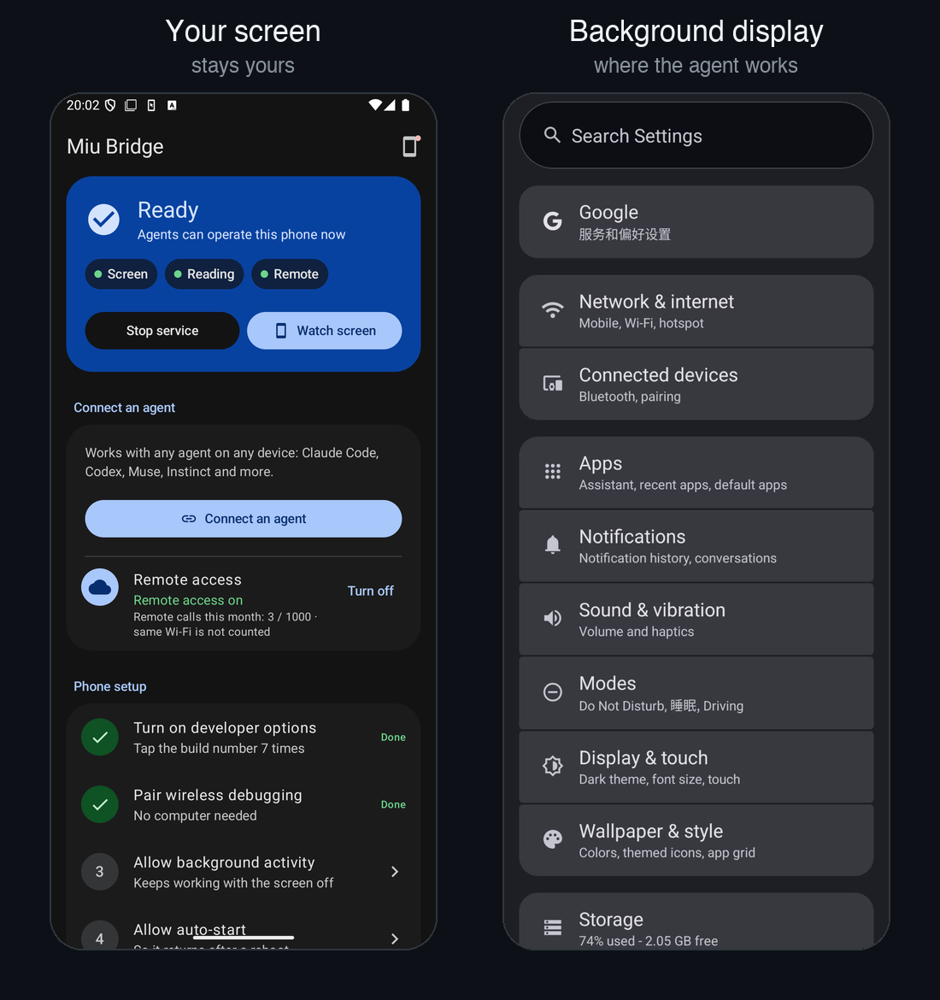

# Miu Bridge

English | [简体中文](README.zh-CN.md)

**Let any AI agent use the apps on your Android phone, while you keep using it.**

[](https://github.com/js8544/miu-bridge/releases/latest)
[](LICENSE)

<p align="center"></p>

Agents work on a **background display** you never see. Your screen stays yours: no app jumps to the
front, nothing is tapped under your thumb, and the agent keeps going with the phone locked in your
pocket. It works with any agent on any device (Claude Code, Codex, or your own) over
[MCP](https://modelcontextprotocol.io) or from a script.

## Install

1. Download the APK from the [latest release](https://github.com/js8544/miu-bridge/releases/latest)
   and install it (Android 11 or later).
2. Open Miu Bridge and follow the checklist. It takes a couple of minutes and needs no computer and
   no account.

A few phones have no Wireless debugging page (HarmonyOS 4, for one); those need a computer once after
each reboot. See [internals](docs/internals.md).

## Connect an agent

Tap **Connect an agent**, copy the text, and paste it to your agent. It holds the phone's address, a
token, and how to use them. That is all the agent needs.

As an MCP server, for example in Claude Code:

```bash
claude mcp add --transport http phone <address> --header "Authorization: Bearer <token>"
```

Or from a script, with the [SDK](sdk/README.md) (Python and JavaScript, one file each):

```python
from miu_bridge import Phone   # reads MIU_BRIDGE_URL and MIU_BRIDGE_TOKEN

phone = Phone()
phone.launch("com.android.settings")
phone.tap("text=Network & internet")
print(phone.snapshot())
```

## What an agent can do

| | |
| --- | --- |
| See | `phone_snapshot` reads the screen as text with a ref for each element; `phone_screenshot` takes a picture |
| Act | `phone_tap`, `phone_long_press`, `phone_swipe`, `phone_type`, `phone_key` |
| Go somewhere | `phone_apps`, `phone_launch`, `phone_open_url`, `phone_wait` |
| Do many steps at once | `phone_script` runs a whole script on the phone in one call |
| Give it back to you | `phone_handoff` puts the app on your screen for a payment, a sign-in or a verification; `phone_takeback` carries on afterwards |

## Good to know

- **Same Wi-Fi needs no server.** From other networks, turn on remote access (no sign-up) and calls
  go through a relay, free for 1,000 remote calls per phone per month. The relay forwards and does
  not store what passes through, and you can [run your own](relay/).
- **The relay can read what it forwards, unless the agent encrypts it.** Agents that use the SDK can
  turn on end-to-end encryption; the relay then carries only ciphertext and never sees the token. A
  plain MCP connection is protected by HTTPS as far as the relay.
- **The token is the key to your phone.** Give it only to agents you trust.
- **You choose which apps agents may open:** every app except a block list, or only an allow list.
- **Android 13 and later** work with the phone locked and the screen off. On Android 12 and earlier
  the phone has to be unlocked while an agent works.
- Automating an app may break that app's terms. That is your call and your responsibility.

## Build it yourself

```bash
./gradlew assembleDebug
```

## More

- [How it works, limits, building](docs/internals.md)
- [Script SDK](sdk/README.md)
- [Run your own relay](relay/README.md)
- [Security](SECURITY.md)

Apache-2.0.
