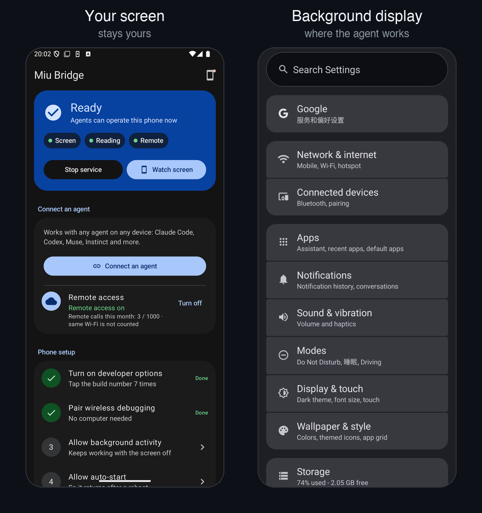

# Miu Bridge

[English](README.md) | 简体中文

**让任何 AI agent 操作你安卓手机上的应用，同时不耽误你自己用手机。**

[](https://github.com/js8544/miu-bridge/releases/latest)
[](LICENSE)

<p align="center"></p>

agent 在一块你看不到的**后台屏**上干活。你的屏幕还是你的：不会有应用突然跳到前面，不会有东西在你手指底下被点掉，手机锁屏放在口袋里时
agent 也能接着做。任何设备上的任何 agent 都能用（Claude Code、Codex，或者你自己写的），通过
[MCP](https://modelcontextprotocol.io) 或脚本接入。

## 安装

1. 从[最新发布页](https://github.com/js8544/miu-bridge/releases/latest)下载 APK 并安装（Android 11 及以上）。
2. 打开 Miu Bridge，照着清单一步步做。大约两分钟，不需要电脑，也不需要注册账号。

少数手机没有“无线调试”页面（比如 HarmonyOS 4），每次重启后需要用电脑连一次，见[实现说明](docs/internals.md)。

## 接入 agent

点**连接一个 agent**，复制那段文字，发给你的 agent。里面有手机的地址、口令和用法，agent 有这些就够了。

当作 MCP 服务器接入，以 Claude Code 为例：

```bash
claude mcp add --transport http phone <地址> --header "Authorization: Bearer <口令>"
```

或者用 [SDK](sdk/README.md) 写脚本（Python 和 JavaScript 各一个文件）：

```python
from miu_bridge import Phone   # 读取环境变量 MIU_BRIDGE_URL 和 MIU_BRIDGE_TOKEN

phone = Phone()
phone.launch("com.android.settings")
phone.tap("text=Network & internet")
print(phone.snapshot())
```

## agent 能做什么

| | |
| --- | --- |
| 看 | `phone_snapshot` 把屏幕读成文字，每个元素带一个引用；`phone_screenshot` 截图 |
| 操作 | `phone_tap`、`phone_long_press`、`phone_swipe`、`phone_type`、`phone_key` |
| 跳转 | `phone_apps`、`phone_launch`、`phone_open_url`、`phone_wait` |
| 一次做很多步 | `phone_script` 一次调用就在手机上跑完一整段脚本 |
| 交还给你 | 遇到付款、登录、验证，`phone_handoff` 把应用放到你的屏幕上；你处理完，`phone_takeback` 接着做 |

## 需要知道的

- **同一个 Wi-Fi 下不需要任何服务器。** 不在同一网络时，打开远程访问（不用注册），调用会经过中转服务器，每台手机每月免费 1000
  次远程调用。中转只转发，不保存经过的内容；你也可以[自己搭一个](relay/)。
- **中转服务器能看到它转发的内容，除非 agent 加密。** 用 SDK 的 agent 可以打开端到端加密，这时中转只看得到密文，也看不到口令。普通的
  MCP 连接由 HTTPS 保护到中转为止。
- **口令就是你手机的钥匙。** 只给你信得过的 agent。
- **哪些应用能被 agent 打开由你定：** 除黑名单外全部可用，或者只允许白名单里的。
- **Android 13 及以上**可以在锁屏、熄屏状态下工作。Android 12 及以下，agent 干活时手机需要保持解锁。
- 自动操作某个应用可能违反它的用户协议。用不用由你决定，责任也由你承担。

## 自己编译

```bash
./gradlew assembleDebug
```

## 更多

以下文档目前只有英文。

- [实现原理、限制、编译](docs/internals.md)
- [脚本 SDK](sdk/README.md)
- [自己搭中转服务器](relay/README.md)
- [安全](SECURITY.md)

Apache-2.0。
